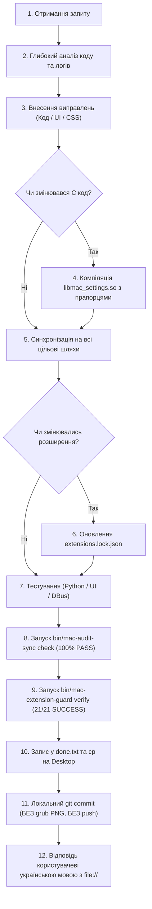

# SILVERHAWK FORK SAFETY OVERRIDE — READ FIRST

> [!CAUTION]
> This file is an **archived upstream agent handbook**, preserved for reference. Its machine-specific paths, language conventions, mandatory one-turn deployment, all-system synchronization, and automatic installation/repair instructions **do not apply to this fork**.
>
> **Governing instructions: [AGENTS.md](AGENTS.md).** Review [COMPATIBILITY.md](COMPATIBILITY.md) and [IMPLEMENTATION_PLAN.md](IMPLEMENTATION_PLAN.md) before any edits. Codex/Claude manages and reviews; Gemini implements scoped tasks. All CI is local/independent ci-farm: **no GitHub Actions**.
>
> The upstream install.sh, uninstall.sh, update, clean-update, apply_plymouth.sh and automated repair/deploy routines are **blocked** on the live workstation. No deployment, sudo, D-Bus Eval helper, GNOME Shell/nautilus replacement, sudoers install, global dconf import, or GDM/GRUB/Plymouth modification without separate explicit user authorization.
>
> This override is intentional. Where the preserved upstream handbook conflicts with AGENTS.md, **follow AGENTS.md**.

---

# macOS Tahoe / Sequoia Transformation Pack for Ubuntu (GNOME Shell 50 на Wayland)
## Головний маніфест, технічна архітектура та керівництво розробника для ШІ / AI Master Handbook

Цей документ є **єдиним джерелом істини (Single Source of Truth)** і обов'язковим технічним маніфестом для будь-якого ШІ-асистента, який працює з цим проектом. Проект розробляється як цілісна комерційна та інженерна екосистема.

> [!IMPORTANT]
> **ГОЛОВНИЙ ПРИНЦИП РОБОТИ — ВИКОНАННЯ ЗАВДАННЯ ЗА ОДИН ЗАПИТ (Single-Turn Execution):**
> Користувач цінує швидкість, точність і повну автономність. ШІ не повинен зупинятися на півдорозі, задавати тривіальні питання або залишати систему в неробочому стані. Отримавши запит, ви зобов'язані:
> 1. Проаналізувати проблему в повному обсязі;
> 2. Внести всі зміни в код/UI;
> 3. Скомпільувати всі необхідні бібліотеки;
> 4. Розгорнути та синхронізувати зміни на **всі** системні шляхи;
> 5. Оновити хеші та пройти автоматичний аудит (`mac-audit-sync check` та `mac-extension-guard verify`);
> 6. Додати запис у `done.txt` та оновити `~/Desktop/done.txt`;
> 7. Зробити локальний git-коміт;
> 8. Надати вичерпну відповідь українською мовою з клікабельними посиланнями `file://`.

---

## 1. Залізні правила та непорушні обмеження (Iron Rules)

> [!CAUTION]
> **ПРАВИЛО 1: СУВОРО ЗАБОРОНЕНО `git push`**
> Ніколи, ні за яких умов не виконуйте команду `git push`, не налаштовуйте віддалені пуші і не надсилайте дані у віддалені репозиторії! Усі коміти мають бути виключно **локальними** (`git commit -m "..."`).

> [!CAUTION]
> **ПРАВИЛО 2: НІКОЛИ НЕ ЧІПАТИ ТА НЕ КОМІТИТИ GRUB PNG-ІКОНКИ**
> Каталоги `grub/apple-mac/icons/`, `grub/apple-mac-usb/icons/`, `grub/apple-mac-usb2/icons/` містять специфічні графічні ресурси. **Ніколи не додавайте їх у `git add`** і не модифікуйте без прямої вимоги користувача. При виконанні комітів додавайте файли точково або виключайте файли grub.

> [!IMPORTANT]
> **ПРАВИЛО 3: МОВА СПІЛКУВАННЯ ТА ЖУРНАЛІВ — ВИКЛЮЧНО УКРАЇНСЬКА**
> Усі відповіді користувачеві в чаті, коментарі до коду, пояснення та звіти у файлі `done.txt` ведуться **суворо українською мовою**.

> [!IMPORTANT]
> **ПРАВИЛО 4: ОБОВ'ЯЗКОВІ КЛІКАБЕЛЬНІ ПОСИЛАННЯ `file://`**
> Кожен згаданий у вашій відповіді файл, каталог, клас або функція **МУСИТЬ** бути оформлений як клікабельне markdown-посилання формату GitHub із протоколом `file://`, наприклад:
> - [`libmac_settings.c`](file:///home/vitaliy/MACTHEMEFILES/control-center/libmac_settings.c)
> - [`cc-widgets-panel.ui`](file:///home/vitaliy/MACTHEMEFILES/control-center/cc-widgets-panel.ui#L705-L735)
> - [`done.txt`](file:///home/vitaliy/MACTHEMEFILES/done.txt)

> [!IMPORTANT]
> **ПРАВИЛО 5: РЕПОЗИТОРІЙ ЯК SOURCE OF TRUTH ТА СИМЛІНК**
> Фізична директорія репозиторію — `/home/vitaliy/macW1Y/`.
> Каталог `/home/vitaliy/MACTHEMEFILES` — це символічне посилання (symlink) на `/home/vitaliy/macW1Y`:
> `MACTHEMEFILES -> /home/vitaliy/macW1Y`
> Вони посилаються на одні й ті самі фізичні файли на диску. Основна робоча директорія — `/home/vitaliy/MACTHEMEFILES`. Будь-яка зміна у live-системі (`~/.local/...`, `/usr/...`) обов'язково дублюється в репозиторій.

> [!IMPORTANT]
> **ПРАВИЛО 6: ЖУРНАЛ `done.txt` ТА `~/Desktop/done.txt`**
> Після успішного завершення завдання:
> 1. Допишіть структурований звіт у кінець [`done.txt`](file:///home/vitaliy/MACTHEMEFILES/done.txt) з наступним порядковим номером Task XXX.
> 2. Скопіюйте оновлений `done.txt` на робочий стіл: `cp done.txt /home/vitaliy/Desktop/done.txt`.

> [!IMPORTANT]
> **ПРАВИЛО 7: ОБОВ'ЯЗКОВИЙ АУДИТ ПЕРЕД ЗВІТУВАННЯМ**
> Перед наданням відповіді користувачеві обов'язково запустіть і переконайтеся у 100% успіху:
> 1. `bin/mac-audit-sync check` — повинен повертати **100% PASS**.
> 2. `bin/mac-extension-guard verify` — повинен повертати **21/21 SUCCESS**.

> [!WARNING]
> **ПРАВИЛО 8: ОЧИЩЕННЯ LD_PRELOAD ПРИ НЕОБХІДНОСТІ**
> Якщо в терміналі виникають помилки з `libmacpopover.so` чи сторонніми бібліотеками, виконуйте системні команди з префіксом:
> ```bash
> LD_PRELOAD= <команда>
> ```

> [!IMPORTANT]
> **ПРАВИЛО 9: РЕГЛАМЕНТ ЗАПИТУ «ОПТИМІЗУЙ СИСТЕМУ»**
> Коли користувач подає запит **«оптимізуй систему»** (або будь-яку його варіацію: аудит конфліктів, усунення накладань, прискорення інтерфейсу), ШІ зобов'язаний діяти строго за планом останніх комплексних аудитів (розділ 6 цього документа):
> 1. **Фаза 1 (Read-Only Audit):** глибокий аудит джерел візуальних змін, подвійних шейдерів, конфліктів розширень і дублювання автозапуску, замір базових метрик RAM/CPU/GPU у стані спокою, Overview та Quick Settings.
> 2. **Фаза 2 (Staged Remediation):** поетапне усунення підтверджених конфліктів за пріоритетами з обов'язковими бекапами (Quick Settings -> Dock -> systemd/autostart -> бінарники -> GTK4 фокус).
> 3. **Фаза 3 (Runtime Validation):** незалежна runtime-перевірка відсутності помилок GJS, відсутності витоків таймерів, повторні заміри продуктивності, порівняльна таблиця «До vs Після», `mac-audit-sync check` (100% PASS) та `mac-extension-guard verify` (21/21 SUCCESS).

---

## 2. Матриця розгортання та синхронізації файлів (Deployment Matrix)

У системі працює декілька шарів оверлеїв (користувацькі та загальносистемні). Зміна файлу лише в одному місці призведе до розсинхронізації та збою `mac-audit-sync`. Завжди синхронізуйте файли за такою матрицею:

### 1. Бібліотека GNOME Settings (`libmac_settings`)
- **Вихідні файли C (мають бути 100% ідентичними)**:
  - `control-center/libmac_settings.c`
  - `gnome-control-center-overlay/libmac_settings.c`
- **Команда компіляції** (зверніть увагу: вихідний `.c` файл ставиться **перед** бібліотеками, щоб лінкер коректно підтягнув `json-glib`):
  ```bash
  gcc -shared -fPIC -O2 control-center/libmac_settings.c $(pkg-config --cflags --libs gtk4 libadwaita-1 json-glib-1.0) -o control-center/libmac_settings.so
  ```
- **Усі цільові шляхи бінарника `.so` (синхронізувати без винятку!)**:
  ```bash
  cp control-center/libmac_settings.so gnome-control-center-overlay/libmac_settings.so
  cp control-center/libmac_settings.so lib/libmac_settings.so
  cp control-center/libmac_settings.so ~/.local/lib/libmac_settings.so
  cp control-center/libmac_settings.so ~/.local/share/gnome-control-center-overlay/libmac_settings.so 2>/dev/null || true
  sudo cp control-center/libmac_settings.so /usr/local/lib/libmac_settings.so
  sudo cp control-center/libmac_settings.so /usr/lib/x86_64-linux-gnu/libmac_settings.so
  sudo cp control-center/libmac_settings.so /usr/share/mactheme/gnome-control-center-overlay/libmac_settings.so
  ```

### 2. UI-файли панелей GNOME Settings (`*.ui`)
Файли інтерфейсу (`cc-widgets-panel.ui`, `cc-power-panel.ui`, `cc-mac-styling-panel.ui`, `cc-window.ui`, `cc-system-panel.ui`, `cc-mouse-panel.ui`):
- `control-center/<file>.ui`
- `gnome-control-center-overlay/<file>.ui`
- `~/.local/share/gnome-control-center-overlay/<file>.ui`
- `/usr/share/mactheme/gnome-control-center-overlay/<file>.ui` (через `sudo cp`)

### 3. GNOME Shell Розширення (21 активне розширення)
- Джерело в репозиторії: `extensions/<uuid>/`
- Системне live-розширення: `~/.local/share/gnome-shell/extensions/<uuid>/`
- **КРИТИЧНО**: після будь-якого редагування файлів розширення обов'язково оновіть хеш у `config/extensions.lock.json`!
  Алгоритм оновлення хешу:
  1. Знайдіть функцію розрахунку хешу директорії в `bin/mac-extension-guard` (сортування файлів, sha256 відносних шляхів і вмісту).
  2. Оновіть поля `sha256` та `pinned_sha256` у `config/extensions.lock.json` для відповідного UUID.
  3. Перевірте командою: `bin/mac-extension-guard verify` (має бути **21/21 SUCCESS**).

### 4. Системні скрипти та утиліти (`bin/`)
- Файли у репозиторії: `bin/<script_name>`
- Системне встановлення: `/usr/local/bin/<script_name>` (через `sudo cp`)
- Перевіряється у тесті [3/5] утиліти `bin/mac-audit-sync check`.

### 5. Теми GTK 3 / GTK 4
- Теми: `macW1Y-Dark`, `macW1Y-Light`, `macW1Y-Dark-solid`, `macW1Y-Light-solid`
- Шляхи: `~/.themes/<theme_name>/`, `/usr/share/themes/<theme_name>/` та в корені репозиторію.

---

## 3. Архітектура ключових підсистем

### 1. Інтегрована панель Параметрів (GNOME Control Center) та `libmac_settings`
`libmac_settings.so` впроваджується в GNOME Settings через механізм `LD_PRELOAD`:
- **Сайдбар та оверлеї**: перехоплює створення `AdwNavigationSplitView` у `cc-window.ui`.
- **Власні розділи**:
  - `widgets` («Віджети»): повне керування віджетами, перемикач режиму редагування, вирівнювання за сіткою, відступи між віджетами, розширені налаштування (`widgets_configurator`), та вбудована галерея додавання віджетів (`widgets_picker`).
  - `mac-styling` («Стилізація macOS»): налаштування ефектів матового скла Liquid Glass, відтінку, розмиття, кольорів акценту.
  - `account` («Обліковий запис»): картка профілю у верхній частині сайдбару з переходом до параметрів користувача.
- **Вбудована галерея вибору віджетів (`widgets_picker`)**:
  - Підсторінка `AdwNavigationPage` з тегом `widgets_picker` всередині `widgets_nav_view`.
  - Містить 19 віджетів з категоріями, іконками, описами та кнопками [Додати].
  - При натисканні на кнопку або активації рядка виконується додавання відповідного об'єкта у GSettings `layout-json` через `json-glib` та виводиться сповіщення `AdwToast`.
  - **Автоматичний життєвий цикл режиму редагування**:
    * Вхід у галерею (`on_dw_add_widgets_clicked` або сигнал `shown` сторінки): `dw_set_edit_mode(TRUE)`.
    * Вихід із галереї (сигнали `hidden` / `popped` при натисканні назад `<`): `dw_set_edit_mode(FALSE)`.
    * Перехід на інший розділ сайдбару: `dw_set_edit_mode(FALSE)` та скидання на `widgets_main`.
    * Закриття вікна Параметрів: `dw_settings_window_close_cb()` скидає `dw_set_edit_mode(FALSE)`.

### 2. Віджети стільниці (`desktop-widgets@r3nhick`)
- **Схема GSettings**: `org.gnome.shell.extensions.desktop-widgets-r3nhick`.
- **Ключі**:
  - `edit-mode` (boolean): активує перетягування, зміну розміру та рамки віджетів.
  - `layout-json` (string): JSON-документ версії 3 зі списком розміщених віджетів:
    ```json
    {
      "version": 3,
      "widgets": [
        {
          "id": "clock-1793898864421",
          "type": "clock",
          "size": "small",
          "x": 24,
          "y": 80,
          "data": {},
          "stack": [],
          "pinned": false
        }
      ]
    }
    ```
  - `open-widget-picker` (boolean): при виклику з меню індикатора запускає `gnome-control-center widgets`.
  - `arrange-widgets` (boolean): запит автовирівнювання за сіткою.

### 3. Рідке матове скло Liquid Glass (`liquid-glass@thinkingcoding1231.gmail.com`)
- Реалізує шейдерний ефект `BackdropGlass` (рефракція, хроматична аберація, внутрішнє підсвічування граней).
- **Важливі правила**:
  - Завжди виключати діалог із власного семплювання скла (`addExclusion`), інакше виникає рекурсивне розмиття.
  - При відкритті викликати `forceRefresh(1)` для захоплення актуального фону.
  - При закритті викликати `destroy()` для запобігання витоку акторів у `Main.layoutManager.uiGroup`.

### 4. Центр сповіщень macOS Tahoe (`kiwi@kemma`)
- Розташування: `apps/tahoeNotifications.js`, `apps/tahoeNotificationCard.js`.
- Дизайн: темно-акрилова картка `rgba(45, 45, 47, 0.76)`, радіус 16px, стопки з виступом, плавне закриття.
- **Адаптивна висота**: контейнер сповіщення повинен вміщувати іконку програми, назву, багаторядкове тіло повідомлення (`line_wrap: true`, `wrap_mode: Pango.WrapMode.WORD_CHAR`) та кнопки дій без накладання чи обрізання.

### 5. Dock-панель та меню
- Док налаштований через `dash2dock-motion` + `cupertino-dock-lite`.
- Стандарт macW1Y: плаваючий док (float dock), фіксований розмір 54px, без connector lock.
- У разі виходу з огляду (overview) фон доку оновлюється під актуальні шпалери за допомогою `bin/mac-dock-fix`.

### 6. Віконні кнопки керування (Traffic Lights)
- Розташовані ліворуч (стиль macOS): червона (закрити), жовта (згорнути), зелена (розгорнути).
- Заголовки вікон: назва програми не дублюється біля кнопок керування.
- Усі кнопки мають рівні пропорції (ширина дорівнює висоті, круглі пілюлі/кружечки за дизайном Cupertino).

### 7. Іконки файлів та асоціації програм
- Для AppImage, deb, exe, zip, tar.xz система повинна показувати специфічні значки застосунків/документів, а не безликі системні заглушки.
- Використовуються MIME-асоціації в `~/.local/share/applications/`, `/usr/share/applications/` та скрипти вилучення іконок.

---

## 4. Покроковий протокол виконання завдання "ЗА ОДИН ЗАПИТ"

Будь-яке нове завдання виконуйте строго за цим протоколом без зупинки:



### Детальні кроки протоколу:

1. **Аналіз**:
   - Знайдіть усі файли, пов'язані з проблемою (використовуйте `grep -rn`, перевіряйте symlink `MACTHEMEFILES` та репозиторій).
   - Якщо помилка у GNOME Shell — перевірте останні логи: `journalctl -xe --since "3 minutes ago" | grep -iE "error|warning|gnome-shell"`.

2. **Редагування**:
   - Внесіть зміни у вихідні файли репозиторію.
   - Дотримуйтесь стандартів відступів, безпечних перевірок об'єктів GObject (`_isActorValid`, перевірка на `DISPOSED`/`FINALIZED`).

3. **Компіляція та розгортання**:
   - Якщо змінено `libmac_settings.c` — скомпільуйте з правильним порядком аргументів:
     `gcc -shared -fPIC -O2 control-center/libmac_settings.c $(pkg-config --cflags --libs gtk4 libadwaita-1 json-glib-1.0) -o control-center/libmac_settings.so`
   - Розкопіюйте бінарник та UI-файли на **всі** обов'язкові шляхи (див. Матрицю розгортання вище).

4. **Оновлення хешів розширень (при необхідності)**:
   - Якщо змінювався код розширення в `extensions/`, оновіть хеш директорії в `config/extensions.lock.json`.
   - Запустіть `bin/mac-extension-guard verify` і переконайтеся у результаті `21/21 SUCCESS`.

5. **Тестування**:
   - Проведіть пряму верифікацію (завантаження UI у Gtk.Builder через Python, емуляція викликів сигналів, перевірка GSettings).

6. **Аудит системи**:
   - Запустіть `bin/mac-audit-sync check`. Результат **МУСИТЬ** бути:
     `AUDIT RESULT: 100% PASS! System and repository are in sync.`

7. **Журнал та коміт**:
   - Сформуйте структурований розділ `Task XXX: <Назва>` у [done.txt](file:///home/vitaliy/MACTHEMEFILES/done.txt).
   - Скопіюйте файл: `cp done.txt /home/vitaliy/Desktop/done.txt`.
   - Додайте файли в індекс git (тільки змінені файли проекту, **БЕЗ** `grub/.../*.png`):
     ```bash
     git add <змінені_файли> done.txt
     git commit -m "feat/fix: опис змін"
     ```
   - **НІКОЛИ НЕ РОБІТЬ `git push`!**

8. **Фінальна відповідь**:
   - Лаконічно, професійно та структуровано українською мовою опишіть вирішення проблеми.
   - Обов'язково вкажіть клікабельні `file://` посилання на всі змінені файли та ключові функції.

---

## 5. Чек-лист типових помилок ШІ (Чого категорично не можна робити)

1. ❌ **Не виконати `git push`**: суворо заборонено!
2. ❌ **Не комітити `grub/.../icons/*.png`**: ці файли не повинні потрапляти до комітів!
3. ❌ **Не оновлювати лише один екземпляр файлу**: у проекті є кілька дзеркал (`control-center/`, `gnome-control-center-overlay/`, `/usr/share/...`). Потрібно оновлювати **всі** дзеркала!
4. ❌ **Не ставити бібліотеки перед сирцем у gcc**: `gcc ... $(pkg-config --libs) file.c` призводить до того, що лінкер викидає бібліотеки! Завжди пишіть: `gcc ... file.c $(pkg-config --libs ...) -o out.so`.
5. ❌ **Не забувати оновити `extensions.lock.json`**: будь-яка зміна у розширенні без оновлення хешу ламає `mac-extension-guard verify`.
6. ❌ **Не забувати про `~/Desktop/done.txt`**: користувач переглядає звіт саме на робочому столі.
7. ❌ **Не залишати текстові шляхи без посилання `file://`**: кожна згадка файлу в чаті має бути клікабельною.
8. ❌ **Не питати очевидних дозволів**: у вас є повний доступ і інструменти — аналізуйте, виправляйте, компілюйте, тестуйте та здавайте готову роботу за один запит!

---

## 6. Регламент виконання запиту «Оптимізуй систему» (Протокол архітектурної оптимізації macW1Y)

Коли користувач звертається із запитом **«оптимізуй систему»**, **«проведи оптимізацію»** або подібним, ШІ **не діє навмання**, а реалізує системний план за протоколом генерального аудиту macW1Y:

### Фаза 1. Повний діагностичний аудит (Read-Only)
1. **Аудит джерел візуальних змін та розширень**:
   - Перевірка взаємодії та стану активних розширень GNOME Shell (`dash2dock-motion`, `cupertino-dock-lite`, `kiwi`, `liquid-glass`, `blur-my-shell`).
   - Перевірка вимкнених системних розширень (`dash-to-dock`, `ubuntu-dock`, `stage-manager`, `isle`, `tiling-assistant`): стан має бути `state: 6` (DISABLED) без залишкових `stateObj`.
   - Аудит шарів графічних ефектів: виявлення подвійних Cogl/GLSL шейдерів, повторного розмиття (Blur/Glass), накладання тіней.
2. **Аудит автозапуску та процесів**:
   - Перевірка служб `systemctl --user list-units --type=service` та процесів демонів macW1Y (`mac-app-manager`, `mac-screenshot-daemon`, `mac-theme-sync`, `mac-touchpad-daemon`).
   - Перевірка каталогів `~/.config/autostart/` та `/etc/xdg/autostart/` на предмет дублювання запуску тих самих скриптів.
3. **Аудит системних бінарників та тем**:
   - Звірка хешів обгорток (`gnome-control-center`, `gnome-shell`, `mac-audit-sync`).
   - Перевірка селекторів фокусу полів вводу GTK3/GTK4 (`entry:focus-within`) на відсутність засвічування білим фоном (`#ffffff`) у темній темі.
4. **Фіксація базових метрик швидкодії та ресурсів**:
   - Зняття показників у стані спокою (Idle): пам'ять GNOME Shell RSS, утилізація CPU, стан дискретної GPU (стан P8, споживання ~4 Вт, температура).
   - Зняття показників при відкритті Overview та відкритті Quick Settings.
   - Перевірка помилок у системному журналі: `journalctl --user -b -u gnome-shell -p 3`.

### Фаза 2. Поетапне усунення підтверджених конфліктів (Staged Remediation)
Робота ведеться послідовно, за чітко визначеними пріоритетами з обов'язковим створенням бекапів у `.backup_*`:
- **Пріоритет 1 (Шейдери Quick Settings)**:
  * Забезпечити єдиного монопольного власника Liquid Glass у Quick Settings — модуль `_tahoeCC` у `kiwi`.
  * У `liquid-glass` вимкнути `enable-quick-settings-glass` (`false`), усунути паразитні таймери запуску (`_qsInitTimerId`), запобігти створенню другого `_qsManager`.
- **Пріоритет 2 (Конкуренція за Dock)**:
  * Закріпити монопольний контроль над геометрією, контейнером дока та ефектом лупи (Magnifier) за `dash2dock-motion`.
  * `cupertino-dock-lite` використовувати виключно для фізики Bounce та Wayland DND reorder, обов'язково вимкнувши перевизначення тем (`override-theming: false`).
  * У `kiwi` вимкнути конфліктні стилі дока (`dock-styling: false`).
  * Уніфікувати колір бейджів сповіщень на червоний `#ff3b30` та стиль індикаторів `DOTS`.
- **Пріоритет 3 (Автозапуск та фонові служби)**:
  * Централізувати фонові демони виключно через `systemd --user` (`mac-app-manager.service`, `mac-screenshot-daemon.service`, `mac-theme-sync.service`).
  * Очистити з `~/.config/autostart/` дубльовані файли `.desktop`. Забезпечити рівно по 1 процесу на демон.
- **Пріоритет 4 (Синхронізація утиліт та бінарників)**:
  * Синхронізувати системні обгортки (`/usr/local/bin/gnome-control-center`, `~/.local/bin`, `bin/`).
  * Внести ключові утиліти до моніторингу `bin/mac-audit-sync`.
- **Пріоритет 5 (Стилі та безпека сесії)**:
  * Забезпечити токенізацію полів вводу GTK через змінні `--mac-input-focus-bg` у `bin/mac-build-theme`.
  * Перевірити коректність шляхів очищення прапорців Watchdog у `$XDG_RUNTIME_DIR`.
- **Обов'язкова синхронізація та фіксація хешів**:
  * Будь-які правки розширень супроводжуються оновленням хешів у `config/extensions.lock.json` та верифікацією через `bin/mac-extension-guard verify`.

### Фаза 3. Незалежна Runtime-валідація та порівняльний звіт
1. Повторне зняття метрик продуктивності та навантаження (RAM Shell, GPU, CPU демонів) у тих самих станах (Idle, Overview, Quick Settings).
2. Інтроспекція стану розширень через DBus/EvalHelper (перевірка `state: 6`, `hasStateObj: false`, активні методи `_tahoeCC`).
3. Перевірка системного журналу на повну відсутність помилок (`journalctl --user -b -u gnome-shell -p 3` має повертати `-- No entries --`).
4. Формування порівняльної таблиці «До vs Після оптимізації» для користувача.
5. Запуск обов'язкових контрольних тестів:
   - `bin/mac-audit-sync check` — **100% PASS**.
   - `bin/mac-extension-guard verify` — **21/21 SUCCESS**.
6. Фіксація результатів у `done.txt`, копіювання на `~/Desktop/done.txt` та локальний `git commit` (БЕЗ push, БЕЗ файлів grub PNG).
