# MACW1Y — TOTAL UI OVERLAP, CONFLICT & DUPLICATION AUDIT
**Повний аудит накладання інтерфейсу, конфліктів стилів, дублювання ефектів та архітектурної синхронізації**  
**Дата проведення:** 13 листопада 2026 р.  
**Проєкт:** macW1Y (macOS Tahoe Transformation Pack for Ubuntu Linux)  
**Цільова система:** Ubuntu 24.04 LTS / GNOME Shell 46.0 / Wayland / X11  
**Статус документа:** ЗВІТ ПОВНОГО АУДИТУ (БЕЗ ВНЕСЕННЯ ДЕСТРУКТИВНИХ ЗМІН)

---

## 1. Резюме аудиту (Executive Summary)

Проведено глибоке сканування всієї системи Ubuntu та проєкту macW1Y на предмет:
1. Конфліктів CSS-стилів та суперечливих правил з `!important`.
2. Подвійного/потрійного накладання візуальних ефектів (Blur, Liquid Glass, тіні, заокруглення).
3. Конфліктних перехоплень методів GNOME Shell (Monkey Patches) та гонок сигналів Clutter.
4. Дублювання демонів та автозапуску (systemd user services vs autostart `.desktop`).
5. Застарілих механізмів, неактивних розширень, старих резервних копій та несинхронізованих системних копій.

### Ключові показники аудиту:
* **Загальна кількість унікальних CSS-селекторів у системі:** 3 249.
* **Перехресних CSS-селекторів, що перекриваються між різними файлами:** 167 (у GNOME Shell) + 251 (у GTK4/Libadwaita).
* **Виявлено критичних прямих конфліктів (CONFIRMED):** 14.
* **Виявлено дублювань відповідальності (DUPLICATE):** 11.
* **Виявлено потенційних конфліктів (POSSIBLE):** 7.
* **Виявлено застарілих / "фантомних" файлів і механізмів:** 16.

---

## 2. Повний реєстр джерел візуальних змін

У системі виявлено **6 незалежних рівнів**, які одночасно впливають на зовнішній вигляд інтерфейсу:

### Рівень 1: Системні бінарні перехоплювачі та Overlays
1. `/usr/bin/gnome-shell` (Wrapper): Інжектує через `G_RESOURCE_OVERLAYS` файл `/usr/share/mactheme/gnome-shell-overlay/ui/layout.js`.
2. `/usr/bin/gnome-control-center` (Wrapper): Інжектує 6 файлів `.ui` через `G_RESOURCE_OVERLAYS` та здійснює `LD_PRELOAD` бібліотек `libmacpopover.so` і `libmac_settings.so`.
3. `/usr/local/bin/gnome-control-center` (Duplicate Wrapper): **Увага!** Друга обгортка, яка має інший набір оверлеїв (відсутні `cc-background-panel.ui` та `preview.css`).
4. `/usr/bin/nautilus` та `/usr/local/bin/nautilus`: `LD_PRELOAD="libmac_nautilus.so:libmacpopover.so"`.
5. `/usr/bin/ptyxis` та `/usr/local/bin/ptyxis`: `LD_PRELOAD="libmac_terminal.so:libmacpopover.so"`.
6. `/usr/local/bin/gnome-calculator`, `gnome-text-editor`, `loupe`: `LD_PRELOAD="libmacpopover.so"`.

### Рівень 2: Активні GNOME Shell Extensions (21 розширення)
1. `appmenu@ChathurangaBW.github.io` — меню програм, пошук Spotlight, Launchpad, перемикач мов, індикатор робочих просторів.
2. `blur-my-shell@aunetx` — апаратне розмиття поверхонь + **монолітний контролер menubar_v29.js**.
3. `compiz-alike-magic-lamp-effect@hermes83.github.com` — анімація мінімізації Magic Lamp (двійна сітка деформації Clutter).
4. `cupertino-dock-lite@rinzler69-wastaken.github.com` — **дублюючий шар анімації та теми дока (WACK project)**.
5. `custom-command-toggle@storageb.github.com` — кастомний тумблер у верхній панелі.
6. `dash2dock-motion@unmade.space` — основний док macW1Y (magnifier, розташування, запуск).
7. `desktop-widgets@r3nhick` — віджети робочого столу, власний шар Liquid Glass та прев'ю в Overview.
8. `eval-helper@mactheme` — оверлей перехідних станів, примусове заокруглення вікон (24px), захист дока, Alt-Tab.
9. `kiwi@kemma` — багатофункціональне розширення: **Control Center, Quick Settings shaders, window controls, dock styling, panel styling**.
10. `liquid-glass@thinkingcoding1231.gmail.com` — рушій скла Cogl: панелі, контекстні меню, док, Quick Settings, OSD.
11. `macos-touchpad-gestures@mactheme` — 3/4-пальцеві жести та перехоплення жестів Overview.
12. `quick-settings-scroll@diskmth.fr` — скролінг слайдерів Quick Settings.
13. `Rounded_Corners@lennart-k` — апаратне заокруглення 4 кутів фізичного дисплея.
14. `run-cmd@custom.extension` — виконання внутрішніх команд.
15. `top-bar-organizer@julian.gse.jsts.xyz` — сортування і приховування елементів верхньої панелі.
16. `user-theme@gnome-shell-extensions.gcampax.github.com` — завантаження теми `macW1Y-Dark`.
17. `volume-percentage-quick-settings@imdarktom` — індикатор гучності.
18. `wack-lockscreen-clock@rinzler69-wastaken.github.com` — macOS годинник та екран блокування.
19. `wifi-hotspot-quick-settings@aryan10.github.io` — точка доступу Wi-Fi.
20. `ding@rastersoft.com` — іконки робочого столу DING.
21. `ubuntu-appindicators@ubuntu.com` — системний трей AppIndicator/KStatusNotifierItem.

### Рівень 3: Теми GTK та GNOME Shell
* `~/.themes/macW1Y-Dark/gnome-shell/gnome-shell.css` (207 КБ, 7 642 рядки).
* `/usr/share/themes/macW1Y-Dark/gnome-shell/gnome-shell.css` (системна копія).
* `~/.config/gtk-4.0/gtk.css` (395 КБ) -> імпортує `macw1y-tokens.css` та `macw1y-components.css`.
* `~/.config/gtk-3.0/gtk.css` (20 КБ) -> імпортує `macw1y-tokens.css`, `titlebuttons3.css` та `macw1y-components.css`.

### Рівень 4: Системні служби (systemd) та Autostart
* `systemd system`: `mac-gamemode.service`, `mac-grub-status.service`, `mac-snap-cursor-override.service`, `mac-touchpad-daemon.service`.
* `systemd user`: `mac-app-manager.service`, `mac-screenshot-daemon.service`, `mac-theme-sync.service`.
* `/etc/xdg/autostart/mac-ensure-extensions.desktop`
* `~/.config/autostart/mac-ensure-extensions.desktop` (**дублюється!**)
* `~/.config/autostart/mac-sync-applications.desktop` (**дублюється з mac-app-manager.service!**)
* `~/.config/autostart/macos-login-sound.desktop`

---

## 3. Аудит дублювання візуальних компонентів

### 3.1. Розмиття (Blur)
| Компонент | Хто обробляє | Механізм | Статус | Вплив |
| :--- | :--- | :--- | :--- | :--- |
| **Панель (Top Bar)** | `blur-my-shell.panel` + `eval-helper` | Clutter pipeline + inline styles | DUPLICATE | Непотрібні повторні виклики |
| **Меню (Popups)** | `liquid-glass` (Cogl shader) | Шейдер скла Cogl | CLEAN | У Stage 4 вимкнено дублювання в BMS |
| **Контекстні меню GTK** | `libmacpopover.so` + `liquid-glass` | Cairo/GTK snapshot + Clutter | CLEAN | Розділено: GTK4/GTK3 vs Shell |
| **Фон Overview** | `eval-helper` + `blur-my-shell.overview` | Подвійне накладання розмиття шпалер | DUPLICATE | У Stage 3 додано перевірку, але код існує в 2 місцях |
| **Віджети столу** | `desktop-widgets` (власний glass) | Власний шейдер `widgetGlass.js` | DUPLICATE | Не синхронізовано з `liquid-glass` |

### 3.2. Рідке скло (Liquid Glass)
| Компонент | Джерела накладання | Суть проблеми | Статус |
| :--- | :--- | :--- | :--- |
| **Quick Settings / Control Center** | 1. `kiwi` (`tahoeControlCenter.js`)<br>2. `liquid-glass` (`quickSettingsManager.js`)<br>3. `blur-my-shell` (`menubar_v29.js`) | `kiwi` імпортує `LiquidEffect` безпосередньо з розширення `liquid-glass` і накладає **власний шейдер** на той самий контейнер, на який `liquid-glass` накладає свій шейдер. `blur-my-shell` одночасно анімує цей же контейнер ламповим ефектом. | **CONFIRMED (CRITICAL)** |
| **Док (Dock)** | 1. `liquid-glass` (`dockManager.js`)<br>2. `dash2dock-motion` (`glass.js`)<br>3. `eval-helper` (`syncDockGlass`) | `dash2dock-motion` має власний вбудований перемикач `glass.js`, тоді як `liquid-glass` створює зовнішній mesh-актор під доком. | **DUPLICATE (HIGH)** |
| **Вікна програм (Window Glass)** | 1. `liquid-glass` (`application-glass`)<br>2. `eval-helper` (`forced-corners`) | `liquid-glass` має білий список вікон для скляного фону, а `eval-helper` накладає шейдер кутів `corner.glsl`. При взаємодії можливі артефакти напівпрозорості. | **POSSIBLE (MEDIUM)** |

### 3.3. Док (Dock) — Архітектурний конфлікт трьох розширень
Виявлено **три розширення, які одночасно маніпулюють доком**:
1. `dash2dock-motion@unmade.space` — основний док (масштабування іконок, відображення кошика, інтеліхайд).
2. `cupertino-dock-lite@rinzler69-wastaken.github.com` — запускає нескінченний інтервал `setInterval(() => this._findDashContainer(), 500)`, знаходить контейнер Dash, підключає власний `Animator`, власний Wayland DND міст та застосовує власний `stylesheet.css`.
3. `kiwi@kemma` — у налаштуваннях встановлено `dock-styling: true`, через що `kiwi` додає клас `.kiwi-dock-styled` і перебиває відступи іконок та колір індикаторів дока.
* **Статус:** **CONFIRMED (CRITICAL)**.
* **Наслідки:** Потрійне накладання обробників миші, ризик смикання іконок при наведенні, конфлікт відступів між `dash2dock-motion` та `cupertino-dock-lite`.

### 3.4. Верхня панель (Top Bar) — Розподіл ролей
1. `appmenu@ChathurangaBW.github.io`: створює меню вікон (File, Edit...), ініціалізує Spotlight і Launchpad.
2. `blur-my-shell/components/menubar_v29.js`: перехоплює активацію додатків (`Shell.App.prototype.activate`), перехоплює кліки на `launchpad.desktop`, переміщує Quick Settings, дату, індикатори мережі та гучності.
3. `top-bar-organizer@julian.gse.jsts.xyz`: перехоплює списки дочірніх елементів `leftBox`, `centerBox`, `rightBox` і примусово приховує `['quickSettings', 'macWifi', 'macBluetooth', 'macVolume', 'macBattery']`.
4. `kiwi@kemma`: додає кнопки `kiwi-search-button` і `kiwi-wifi-button`, накладає темні/світлі кольори тексту через `.kiwi-panel-dark-text`.
* **Статус:** **CONFIRMED (HIGH)**. Організація панелі розкидана між чотирма компонентами.

---

## 4. Реєстр конфліктів CSS та стилів

Нижче наведено підтверджені колізії, де два або більше файлів призначають суперечливі правила одному й тому самому елементу:

| № | Селектор | Файл 1 (Рядок / Значення) | Файл 2 (Рядок / Значення) | Яке правило перемагає | Наслідки для інтерфейсу | Статус / Пріоритет |
| :-: | :--- | :--- | :--- | :--- | :--- | :-: |
| **C1** | `.appmenu-popup-menu-content` | `gnome-shell.css:6429`<br>`border-radius: 24px !important;`<br>`border: 1px solid rgba(255,255,255,0.20) !important;` | `appmenu/stylesheet.css:266`<br>`border-radius: 14px !important;`<br>`border: 1px solid rgba(255,255,255,0.18) !important;` | Залежить від черги завантаження розширень | Стрибки радіуса меню між 24px та 14px під час увімкнення/вимкнення розширень | **CONFIRMED / HIGH** |
| **C2** | `.appmenu-popup-menu-content` | `liquid-glass/stylesheet.css:119`<br>`border-radius: 20px !important;`<br>`border: 1px solid rgba(255,255,255,0.16) !important;` | `gnome-shell.css:6429`<br>`border-radius: 24px !important;` | `liquid-glass` (якщо завантажено пізніше) | Третє значення радіуса для того самого меню (20px замість 24px) | **CONFIRMED / HIGH** |
| **C3** | `.popup-sub-menu` | `gnome-shell.css:2634`<br>`background: rgba(255,255,255,0.15) !important;`<br>`border-radius: 20px !important;` | `gnome-shell.css:6313`<br>`border-radius: 24px !important;`<br>`liquid-glass:97`: `background: transparent !important;` | Останнє правило у файлі / розширенні | Внутрішній конфлікт у самій темі `gnome-shell.css` між лініями 2634 та 6313 | **CONFIRMED / MEDIUM** |
| **C4** | `#panel .panel-button.screen-sharing-indicator` | `gnome-shell.css:2378`<br>`box-shadow: inset 0 0 0 1000px #E9873A !important;` (Помаранчевий) | `kiwi/stylesheet.css:695`<br>`background-color: rgba(191, 90, 242, 0.9);`<br>`border-radius: 10px;` (Фіолетовий) | `gnome-shell.css` (через `!important`) | Конфлікт палітри кольору індикатора трансляції екрана | **CONFIRMED / LOW** |
| **C5** | `#panel .panel-button.clock-display .clock` | `gnome-shell.css:2300`<br>`padding: 0 10px !important;` | `kiwi/stylesheet.css:66`<br>`padding-left: 6px !important;`<br>`padding-right: 6px !important;` | Залежить від порядку завантаження | Смикання ширини годинника при перезавантаженні kiwi | **CONFIRMED / MEDIUM** |
| **C6** | `#dashtodockContainer .notification-badge` | `gnome-shell.css:5422`<br>`background-color: -st-accent-color;`<br>`border-radius: 9999px;` | `dash2dock/stylesheet.css:1344`<br>`background-color: red;`<br>`border-radius: 1em;` | `gnome-shell.css` | Неузгодженість кольору бейджа сповіщень на іконках дока | **DUPLICATE / LOW** |
| **C7** | `entry:focus-within` (GTK4) | `gtk.css:550`<br>`box-shadow: inset 0 0 0 2px color-mix(...)` | `macw1y-components.css:1843`<br>`background-color: #ffffff;`<br>`border-color: rgba(255, 106, 0, 0.50);` | `macw1y-components.css` (імпортується останнім) | **Критичний баг темної теми!** У темній темі при фокусі на полі вводу фон стає білим, а білий текст не видно | **CONFIRMED / CRITICAL** |
| **C8** | `entry` (GTK4 розміри) | `gtk.css:562`<br>`min-height: 24px; padding: 2px 8px; border-radius: 6px;` | `macw1y-components.css:1711`<br>`min-height: 28px; padding: 2px 10px; border-radius: 8px;` | `macw1y-components.css` | Неузгодженість висоти інпутів у діалогах | **DUPLICATE / MEDIUM** |
| **C9** | `windowcontrols button` (GTK4) | `gtk.css:2780-2886`<br>Повний набір правил для світлофора | `macw1y-components.css:2162-2366`<br>Повний дублікат правил для світлофора | `macw1y-components.css` | Подвійне парсування однакових 200+ рядків CSS для кожної GTK4 програми | **DUPLICATE / LOW** |
| **C10** | `.quick-settings` | `gnome-shell.css:4486`<br>`border-radius: 33px !important;` | `liquid-glass/stylesheet.css:105`<br>`border: none !important;` | Обидва діють (border vs radius) | Тіні та межі Quick Settings | **CLEAN** |

---

## 5. Реєстр конфліктів JavaScript та GNOME Extensions

### 5.1. Карта глобальних змінних (`globalThis` / `global`)
Виявлено спільні глобальні змінні, через які розширення неявно спілкуються або перезаписують функції одне одного:

1. `globalThis._macSpotlightToggle` — встановлюється та викликається з **4 розширень**: `blur-my-shell`, `kiwi`, `eval-helper`, `appmenu`.
2. `globalThis.toggleMacApplications` — маніпулюється з **4 розширень**: `blur-my-shell`, `macos-touchpad-gestures`, `eval-helper`, `appmenu`.
3. `globalThis._tahoeQSToggle` — встановлюється в `blur-my-shell`, `kiwi` та `run-cmd`.
4. `globalThis.__AppmenuGradientBlurFadeEffect` — дублюється в `kiwi` та `appmenu`.
5. `global._liquidGlassDockSync` — викликається з `liquid-glass`, `dash2dock-motion`, `eval-helper`.
6. `globalThis.Clutter`, `GLib`, `Gio`, `Main`, `Meta` — інжектуються в глобальний простір `globalThis` розширеннями `blur-my-shell` та `eval-helper`.
* **Ризик:** Якщо одне розширення вимикається (crash або оновлення), глобальна функція зникає або стає `undefined`, що викликає падіння інших 3 розширень при натисканні клавіш Spotlight чи Launchpad.

### 5.2. Конфлікти Monkey Patches (перехоплення прототипів Clutter/Shell)
| Цільовий клас та метод | Хто перехоплює | Потенційний конфлікт / Ризик | Пріоритет |
| :--- | :--- | :--- | :-: |
| `ControlsManager.prototype._shiftState` | `macos-touchpad-gestures`, `blur-my-shell`, `eval-helper` | Ланцюжок викликів `_origShiftState`: якщо порядок увімкнення змінюється, розрахунок зміщення робочих просторів в Overview збивається. *(У Stage 3 захищено атомарним прапорцем, але архітектурно є потрійним патчем).* | **HIGH** |
| `Shell.App.prototype.activate` | `blur-my-shell/components/menubar_v29.js:2555` | Перехоплює будь-яку активацію програми з системи, щоб зловити клік по Launchpad. Втручання в глобальну диспетчеризацію запуску додатків. | **MEDIUM** |
| `BoxPointer.BoxPointer.prototype.open / close` | `eval-helper@mactheme:3431, 3500` | Глобально змінює анімацію та логіку всіх спливаючих вікон GNOME Shell. | **MEDIUM** |
| `EffectClass.prototype.attachTo / detach` | `appmenu` (`gradientBlurFade.js`) та `kiwi` (`gradientBlurFade.js`) | Два різних розширення містять **ідентичний клас-клон**, який реєструється в GObject з однаковими іменами методів. | **HIGH** |
| `Main.wm._minimizeWindow` | `compiz-alike-magic-lamp-effect` | Перехоплює мінімізацію вікон у Mutter. | **CLEAN (Оптимізовано)** |
| `mag.constructor.prototype._isPointerOverDock` | `eval-helper@mactheme:877` | Вклинюється у внутрішній розрахунок лупи `dash2dock-motion`. | **LOW** |

---

## 6. Аудит повторного застосування налаштувань та автозапуску

### 6.1. Подвійний запуск фонових демонів
1. **Служба синхронізації додатків (`mac-sync-applications daemon`):**
   * Запускається як користувацький юніт systemd: `~/.config/systemd/user/mac-app-manager.service`.
   * **Одночасно** запускається через XDG autostart: `~/.config/autostart/mac-sync-applications.desktop`.
   * *Наслідок:* Два процеси намагаються паралельно моніторити директорії додатків `/usr/share/applications` та `~/.local/share/applications`.
   * *Статус:* **CONFIRMED (HIGH)**.

2. **Сторожовий скрипт розширень (`mac-ensure-extensions.sh`):**
   * Запускається через глобальний XDG autostart: `/etc/xdg/autostart/mac-ensure-extensions.desktop`.
   * **Одночасно** запускається через локальний XDG autostart: `~/.config/autostart/mac-ensure-extensions.desktop`.
   * *Наслідок:* Подвійний запуск одного й того самого циклу опитування D-Bus та gsettings при вході користувача.
   * *Статус:* **CONFIRMED (MEDIUM)**.

### 6.2. Невідповідність шляхів Watchdog у `layout.js`
* У `bin/gnome-shell` та `/usr/bin/gnome-shell` (Stage 8) шлях до файлів стану watchdog перенесено до `$XDG_RUNTIME_DIR/mactheme-overlay-launching`.
* Проте всередині `/usr/share/mactheme/gnome-shell-overlay/ui/layout.js` (рядки 1311 та 1346) код досі намагається видалити застарілий шлях `/var/tmp/mactheme-overlay-launching`!
* *Наслідок:* Файл у `$XDG_RUNTIME_DIR` не очищається самим `layout.js`, що створювало ризик хибного спрацьовування аварійного режиму Safe Mode.
* *Статус:* **CONFIRMED (HIGH)**.

### 6.3. Розбіжність обгорток `gnome-control-center`
* `/usr/bin/gnome-control-center` містить повний список оверлеїв (включаючи `cc-background-panel.ui` та `preview.css`).
* `/usr/local/bin/gnome-control-center` містить **старий скорочений список** без шпалер та прев'ю CSS.
* Оскільки `/usr/local/bin` має вищий пріоритет у `$PATH`, ніж `/usr/bin`, ручний запуск з консолі або термінала викликає стару обгортку, а системний запуск (через `.desktop` файл) викликає нову!
* *Статус:* **CONFIRMED (CRITICAL)**.

---

## 7. Реєстр застарілих файлів та залишків попередніх версій

Під час аудиту знайдено невикористовувані або застарілі файли, які залишилися від попередніх ітерацій macW1Y:

### 7.1. Застарілі резервні копії в системних каталогах:
1. `/usr/local/bin/mac-gamemode.audit_backup` (20 КБ) — старий бекап.
2. `/usr/local/bin/mac-gamemode.bak` (23 КБ) — старий бекап.
3. `/usr/local/bin/mac-sync-applications.bak` (49 КБ) — старий бекап.

### 7.2. Застарілі файли стилів у конфігурації користувача:
1. `~/.config/gtk-3.0/fixes3.css` — старий файл виправлень, більше не імпортується в `gtk.css`.
2. `~/.config/gtk-4.0/fixes4.css` — старий файл виправлень, більше не імпортується в `gtk.css`.
3. `~/.config/gtk-3.0/titlebuttons-size-small3.css` — сирота (не імпортується).
4. `~/.config/gtk-4.0/titlebuttons-size-small4.css` — сирота (не імпортується).
5. `~/.config/gtk-4.0/titlebuttons4.css` — у репозиторії імпортується, а в `~/.config/gtk-4.0/gtk.css` імпорт видалено (правила здубльовані в `macw1y-components.css`).

### 7.3. Неактивні сторонні розширення в системних каталогах:
1. `/usr/share/gnome-shell/extensions/isle@zickrian.github.io` — розширення Dynamic Island (вимкнене).
2. `/usr/share/gnome-shell/extensions/desktop-widgets@r3nhick` — **стара версія**, яка відрізняється від актуальної версії в `~/.local/share/gnome-shell/extensions/desktop-widgets@r3nhick`.
3. `~/.local/share/gnome-shell/extensions/dash-to-dock@micxgx.gmail.com` — залишкові файли вимкненого оригінального Dash to Dock.
4. `~/.local/share/gnome-shell/extensions/stage-manager@gnome-stage-manager` — залишкові файли Stage Manager.
5. `~/.local/share/gnome-shell/extensions/ubuntu-dock@ubuntu.com` — залишкові файли стокового Ubuntu Dock.

---

## 8. Системні Overlays та бінарні перехоплювачі

Нижче наведено всі задіяні системні механізми підміни ресурсів:

```
┌────────────────────────────────────────────────────────────────────────┐
│                        GNOME Shell Launch Flow                         │
└────────────────────────────────────────────────────────────────────────┘
                                    │
                                    ▼
                      /usr/bin/gnome-shell (Wrapper)
                                    │
          ┌─────────────────────────┴─────────────────────────┐
          │ G_RESOURCE_OVERLAYS:                              │
          │ /org/gnome/shell/ui/layout.js =                   │
          │ /usr/share/mactheme/gnome-shell-overlay/ui/layout.js
          └─────────────────────────┬─────────────────────────┘
                                    ▼
                         gnome-shell.real (Binary)
                                    │
       ┌────────────────────────────┼────────────────────────────┐
       ▼                            ▼                            ▼
  eval-helper             blur-my-shell (BMS)                  kiwi
  (Alt-Tab,               (menubar_v29.js,               (tahoeControlCenter,
   Forced Corners,         popup blur,                    QuickSettings,
   Watchdog signal)        overview blur)                 Window buttons)
```

### Механізми перехоплення застосунків (GTK4/GTK3):
* **GNOME Control Center:**
  `G_RESOURCE_OVERLAYS` підміняє 6 UI файлів (`cc-window.ui`, `cc-system-panel.ui`, `cc-power-panel.ui`, `cc-mouse-panel.ui`, `cc-background-panel.ui`, `preview.css`).
  `LD_PRELOAD` інжектує `libmacpopover.so` (заокруглення меню та фізика пружин) + `libmac_settings.so` (вкладка macOS Styling, перемикання теми, шрифти, акцентні кольори).
* **Nautilus (Файли):**
  `LD_PRELOAD` інжектує `libmac_nautilus.so` + `libmacpopover.so`.
* **Ptyxis (Термінал):**
  `LD_PRELOAD` інжектує `libmac_terminal.so` + `libmacpopover.so`.

---

## 9. Карта візуальних залежностей (Visual Dependency Map)

Діаграма демонструє перетин зон відповідальності та джерела накладання ефектів між компонентами:

```mermaid
flowchart TD
    subgraph TopBarZone["Верхня панель (Top Bar / Menubar)"]
        AM["appmenu<br>(Меню програм, Launchpad)"] -->|Текст меню, кнопки| PNL["GNOME Panel Actor"]
        BMS_MB["blur-my-shell: menubar_v29.js<br>(Переміщення QuickSettings, індикатори)"] -->|Зміна позиції віджетів| PNL
        TBO["top-bar-organizer<br>(Сортування контейнерів)"] -->|Приховування/порядок| PNL
        KW_P["kiwi: panelStyling<br>(Адаптивні кольори тексту)"] -->|CSS .kiwi-panel-styled| PNL
        EH_P["eval-helper<br>(Стилі панелі)"] -->|Inline styles| PNL
    end

    subgraph DockZone["Док (Dock System)"]
        D2D["dash2dock-motion<br>(Основний док, іконки, magnifier)"] -->|dashtodockContainer| DCK["Док на екрані"]
        CDL["cupertino-dock-lite<br>(WACK Animator, 500ms poller)"] -->|Конфлікт анімацій| DCK
        LG_D["liquid-glass: DashManager<br>(Шейдер рідкого скла Cogl)"] -->|Mesh-актор під доком| DCK
        KW_D["kiwi: dockStyling<br>(dock-styling=true)"] -->|CSS відступи та крапки| DCK
        EH_D["eval-helper<br>(Magnifier guard, glass sync)"] -->|Сигнали switch-workspace| DCK
        GSC_D["gnome-shell.css<br>(150+ рядків перевизначень)"] -->|Стилі дока| DCK
    end

    subgraph QSZone["Панель керування (Quick Settings)"]
        KW_QS["kiwi: tahoeControlCenter.js<br>(Власний LiquidEffect)"] -->|Дублюючий шейдер| QS["quickSettings.menu"]
        LG_QS["liquid-glass: QuickSettingsManager<br>(Шейдер скла)"] -->|Основний шейдер скла| QS
        BMS_QS["blur-my-shell: menubar_v29.js<br>(Лампові переходи)"] -->|Анімації відкриття/закриття| QS
        GSC_QS["gnome-shell.css<br>(border-radius: 33px)"] -->|Прозорий фон| QS
    end

    subgraph OverviewZone["Переходи Overview"]
        MTG["macos-touchpad-gestures<br>(Жести та _shiftState)"] -->|Патч ControlsManager| OV["Main.overview"]
        BMS_OV["blur-my-shell: overview.js<br>(Розмиття шпалер)"] -->|Патч ControlsManager| OV
        EH_OV["eval-helper<br>(Зсув робочих просторів)"] -->|Корекція геометрії| OV
        DW_OV["desktop-widgets<br>(Синхронізація віджетів)"] -->|Оновлення прев'ю| OV
    end

    subgraph WindowsZone["Вікна застосунків (Windows & Corners)"]
        ML["compiz-alike-magic-lamp-effect<br>(Деформація сітки Clutter)"] -->|Мінімізація вікон| WIN["Вікна програм"]
        EH_W["eval-helper: forced-corners<br>(Шейдер corner.glsl 24px)"] -->|Заокруглення кутів вікон| WIN
        GTK_W["GTK3/GTK4 Themes<br>(border-radius: 24px)"] -->|Клієнтський CSD рендеринг| WIN
        RC_W["Rounded_Corners<br>(Монітор)"] -->|4 кути екрана| DISP["Фізичний дисплей"]
    end
```



---

## 10. Рекомендована централізована архітектура macW1Y

Для усунення хаосу та забезпечення 100% передбачуваності системи пропонується запровадити **Принцип єдиного джерела відповідальності (Single Responsibility Principle)**:

### 1. Єдиний власник Дока (Dock Domain):
* **Власник:** `dash2dock-motion@unmade.space`.
* **Рішення:** 
  1. Вимкнути розширення `cupertino-dock-lite@rinzler69-wastaken.github.com`. Усі необхідні функції пружинної анімації, масштабування іконок та відступів уже реалізовані всередині `dash2dock-motion`. Ліквідація 500ms інтервалу звільнить CPU.
  2. У `kiwi@kemma` вимкнути параметр `dock-styling` (`gsettings set org.gnome.shell.extensions.kiwi dock-styling false`), щоб `kiwi` не перебивав відступи іконок.
  3. `liquid-glass` залишається єдиним постачальником скляної підкладки.

### 2. Єдиний власник Quick Settings / Control Center:
* **Власник:** `kiwi@kemma` (Tahoe Control Center) або `liquid-glass`.
* **Рішення:** 
  Усунути подвійне накладання шейдерів `LiquidEffect`. Якщо використовується Tahoe Control Center від `kiwi`, у `liquid-glass` необхідно вимкнути накладання скла на Quick Settings (`quick-settings-apply-to = 0` або `blur-radius = 0`), щоб уникнути подвійного відмальовування FBO буферів на GPU.

### 3. Єдиний власник Верхньої панелі (Top Bar Domain):
* **Власник елементів:** `appmenu` (глобальне меню програм, Spotlight, Launchpad).
* **Власник порядку:** `top-bar-organizer` (позиціонування елементів).
* **Виправлення:** Прибрати дублюючі Launchpad-хуки з `blur-my-shell/menubar_v29.js`.

### 4. Виправлення критичного багу темної теми у GTK4 (Dark Theme Input Bug):
* **Файл:** `~/.config/gtk-4.0/macw1y-components.css` (рядок 1843) та `bin/mac-build-theme`.
* **Виправлення:** Замінити жорстко закодований `background-color: #ffffff;` у селекторі `entry:focus-within` на змінну `var(--mac-input-focus-bg, rgba(255, 255, 255, 0.12))`.

### 5. Синхронізація обгорток та очищення сторожових файлів:
* Уніфікувати `/usr/local/bin/gnome-control-center` з `/usr/bin/gnome-control-center`.
* У `layout.js` (рядки 1311, 1346) оновити шлях очищення прапорця на `$XDG_RUNTIME_DIR/mactheme-overlay-launching`.
* Прибрати дублювання `mac-ensure-extensions.desktop` з `~/.config/autostart/`.
* Прибрати дублювання `mac-sync-applications.desktop` з `~/.config/autostart/` (залишити чистий systemd user юніт).

---

## 11. Покроковий план ліквідації конфліктів (Action Plan)

> [!IMPORTANT]
> **УВАГА:** Цей план сформовано виключно як пропозиція для узгодження. Жодних дій не буде виконано без прямої команди користувача.

| Крок | Дія | Що виправляється | Оцінка ризику |
| :-: | :--- | :--- | :-: |
| **Крок 1** | Виправлення багу білого фону інпутів у GTK4 (`entry:focus-within`) у `bin/mac-build-theme` та перекомпіляція теми | Ліквідація проблеми невидимого тексту в темній темі | **Нульовий (Безпечно)** |
| **Крок 2** | Уніфікація радіуса спливаючих меню до 24px (приведення `appmenu/stylesheet.css` та `liquid-glass/stylesheet.css` до стандарту `gnome-shell.css`) | Ліквідація стрибків форми контекстних меню | **Нульовий (Безпечно)** |
| **Крок 3** | Вимкнення дублюючого розширення `cupertino-dock-lite` та вимкнення `kiwi dock-styling` | Усунення потрійного конфлікту керування доком, покращення плавності Dash to Dock | **Мінімальний** |
| **Крок 4** | Синхронізація обгортки `/usr/local/bin/gnome-control-center` з `/usr/bin/gnome-control-center` | Відновлення доступу до прев'ю шпалер та запобігання гонкам версій | **Нульовий (Безпечно)** |
| **Крок 5** | Виправлення шляхів видалення прапорця watchdog у `layout.js` | Захист від випадкового скидання в safe mode | **Нульовий (Безпечно)** |
| **Крок 6** | Видалення дублікатів автозапуску в `~/.config/autostart/` (`mac-ensure-extensions.desktop` та `mac-sync-applications.desktop`) | Зменшення часу завантаження сесії, ліквідація паралельних процесів | **Нульовий (Безпечно)** |
| **Крок 7** | Очищення старих файлів-бекапів (`.bak`, `.audit_backup`) та неактивних розширень (`isle`) | Зменшення дискового сміття, чистота репозиторію | **Нульовий (Безпечно)** |
| **Крок 8** | Фінальна валідація цілісності (`mac-audit-sync check`, `mac-extension-guard verify`, `mac-i18n-verify`) | Гарантія 100% працездатності системи | **Нульовий (Безпечно)** |

---
**Звіт підготовлено:** Antigravity AI  
**Версія звіту:** 1.0 (Final Audit)
