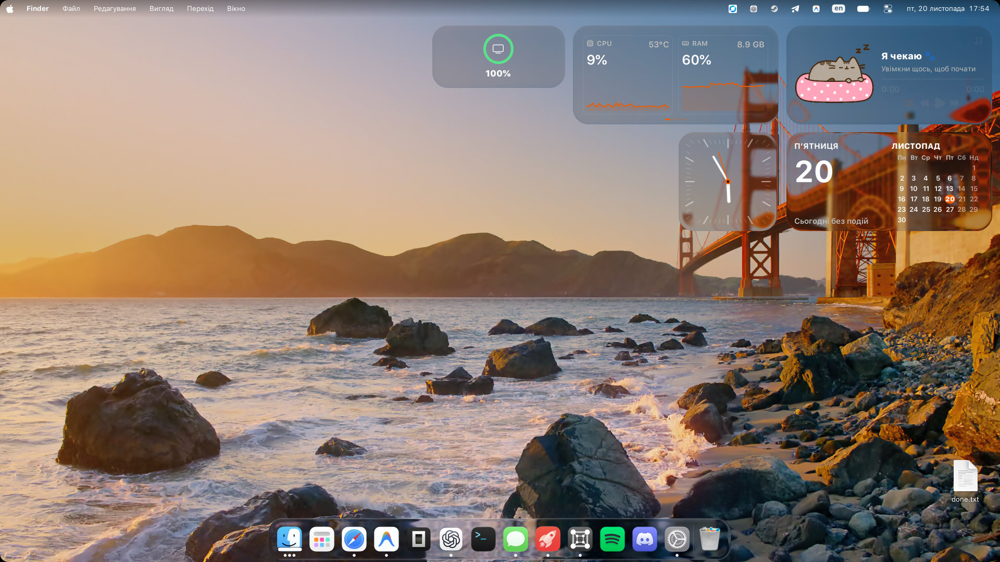
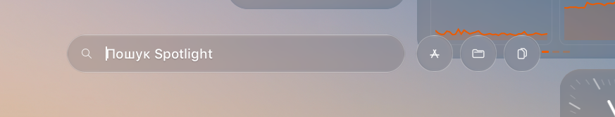
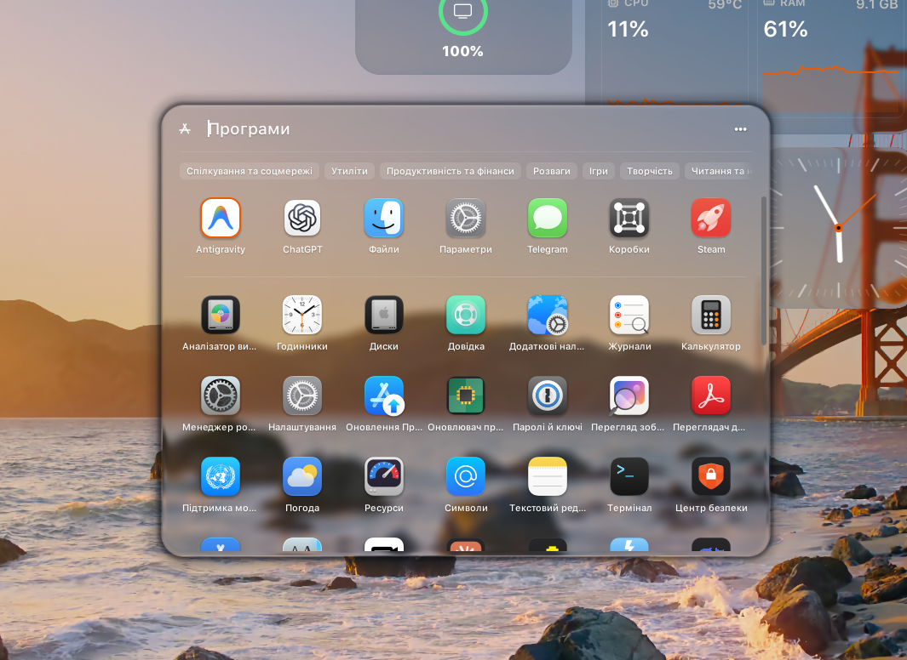
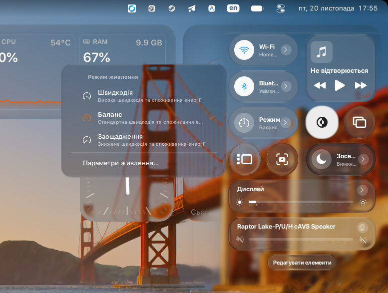
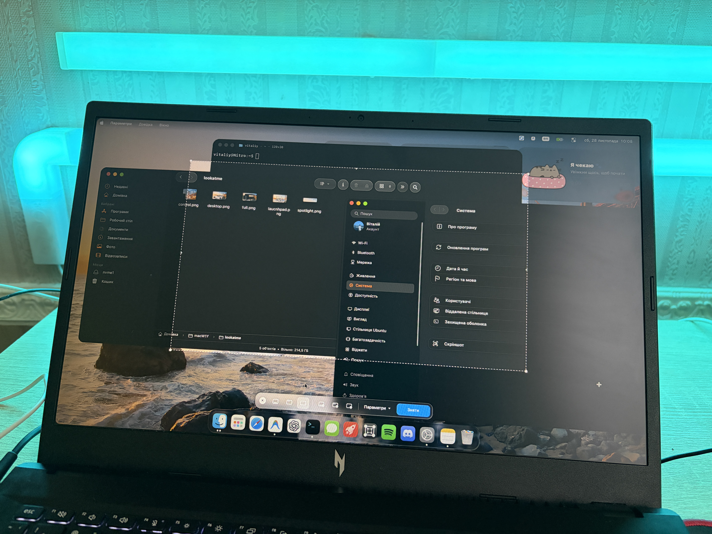

# macW1Y — macW1Y Experience on GNOME

[](https://ubuntu.com/) [](https://debian.org/) [](https://fedoraproject.org/) [](https://archlinux.org/) [](https://cachyos.org/) [](https://www.gnome.org/) [](https://github.com/w1nyear)

---

**macW1Y** is a complete, pixel-perfect transformation suite and performance modpack for Linux distributions running **GNOME Shell on Wayland or X11** (Ubuntu, Debian, Fedora, Arch Linux, and CachyOS). It delivers authentic styling, GTK3/GTK4 themes, Liquid Glass shaders, Default typography, animated GRUB/Plymouth boot screens, hardware multitouch gestures, desktop widgets, hybrid GPU optimization, and an overhauled Control Center and Settings experience.

---

## Screenshots

### Desktop



### Spotlight



### Launchpad



### Control Center



### Full desktop with apps



---

## Compatibility

| Component | Specification |
|---|---|
| Distributions | Ubuntu (24.04–26.10), Debian, Fedora, Arch Linux, CachyOS |
| Desktop | GNOME Shell 46–51 |
| Display server | Wayland, X11 |
| Bootloader | GRUB 2, systemd-boot |
| Package manager | APT, DNF, Pacman |
| Architecture | x86_64 |

## System Requirements

| Component | Minimum | Recommended |
|---|---|---|
| RAM | 4 GB | 8–16 GB |
| CPU | 2 cores / 4 threads, 64-bit (e.g., Intel Core i3 8th Gen / AMD Ryzen 3) | 4–8 cores / 8–12+ threads (e.g., Intel Core i5 11th–13th Gen / AMD Ryzen 5 5000+) |
| GPU | OpenGL 3.3+ (Intel HD Graphics 520+, AMD Radeon R5/R7, NVIDIA GT 710+) | Intel UHD / Iris Xe Graphics, AMD Radeon Graphics, NVIDIA GTX 1050+ |
| Storage | 4 GB | 10 GB SSD |
| Display | 1366 × 768 @ 60 Hz | 1920 × 1080 @ 60–120+ Hz |

> **Note on Liquid Glass Performance:** Thanks to baked bevel map caching and multithreaded strip rendering (scaling up to 8 worker threads), the Liquid Glass shader runs smoothly even on dual-core CPUs and reaches **1,000+ FPS** in the 50-element benchmark on modern multi-core processors.

---

## Installation

```bash
git clone https://github.com/w1nyear/macW1Y-GTK-Theme.git macW1Y
cd macW1Y
chmod +x install.sh
./install.sh
```

## Uninstallation

Run `./install.sh` and select **Uninstall** in the installer menu.

---

## Multitouch Gestures

- **3-Finger Circle Drag:** Move active/topmost window across screens; unmaximizes upon drag.
- **3-Finger Horizontal Swipe Up/Down:** Toggle Mission Control (Overview).
- **3-Finger Vertical Swipe Left/Right:** Window switching (Alt+Tab).
- **3-Finger Pinch In / Out:** Copy (`Ctrl+C`) / Paste (`Ctrl+V`).
- **4-Finger Single Tap:** Toggle Overview.
- **4-Finger Double Tap:** Open Launchpad / App Grid.
- **4-Finger Horizontal Swipe:** Switch virtual workspaces.

---

## Integrated Projects & License

- **Widgets:** Integrated desktop widgets by [r3nhick](https://github.com/r3nhick/desktop-widgets) (GPLv3).
- **Author:** Vitaliy ([w1nyear](https://github.com/w1nyear))
- **License:** GNU General Public License v3.0 (GPLv3).
- **Version:** 0.7
